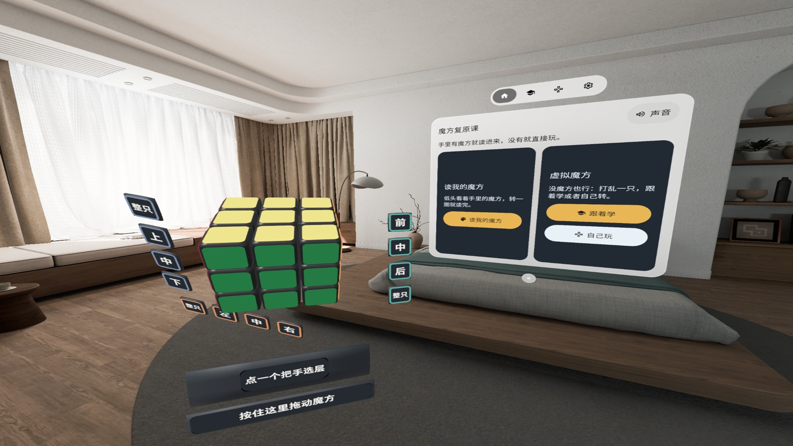
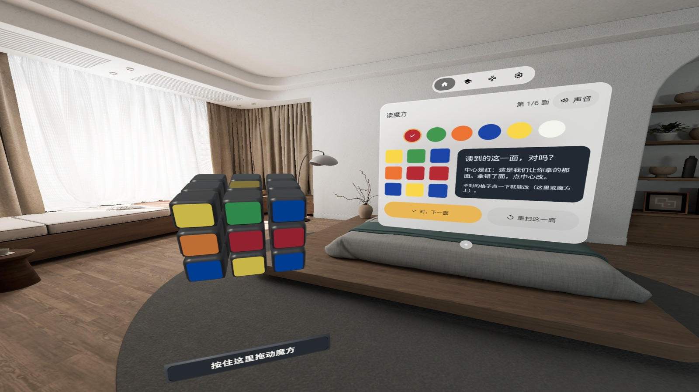
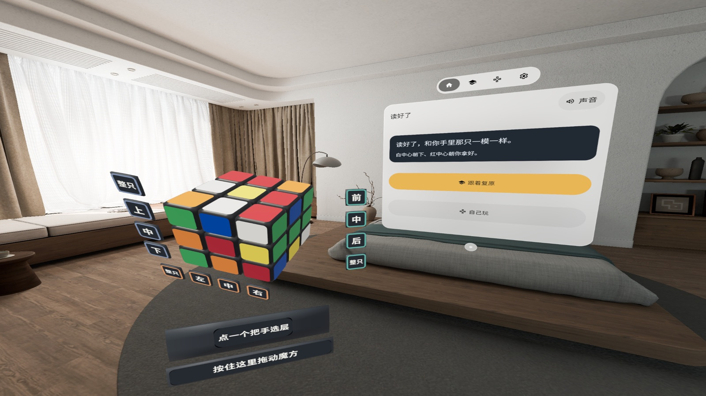
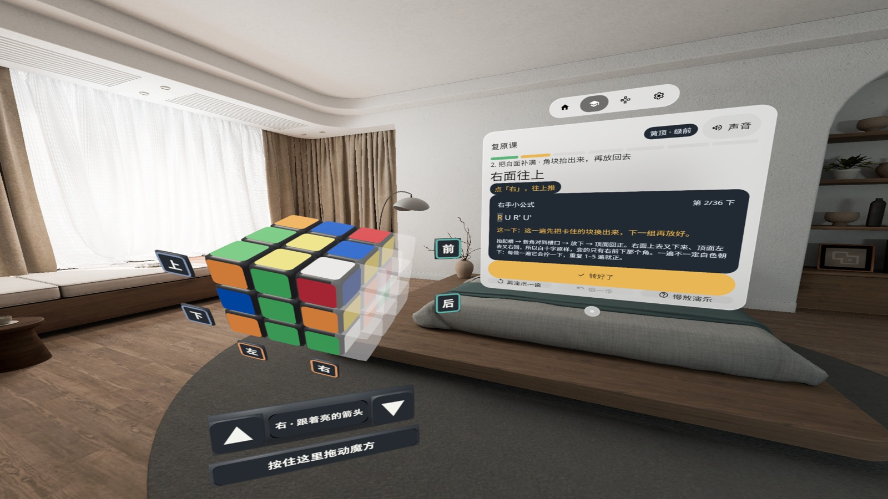
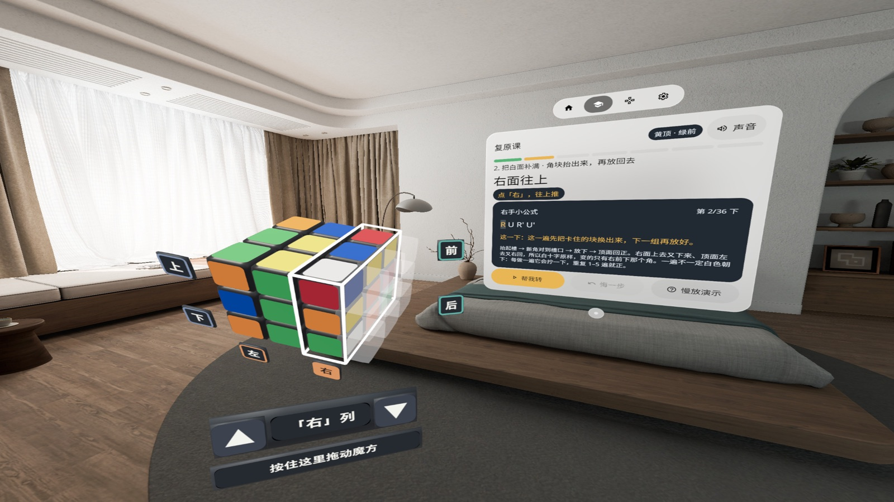
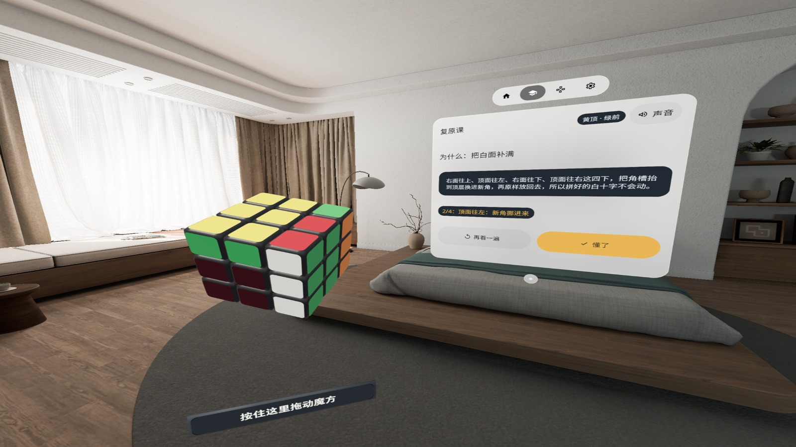
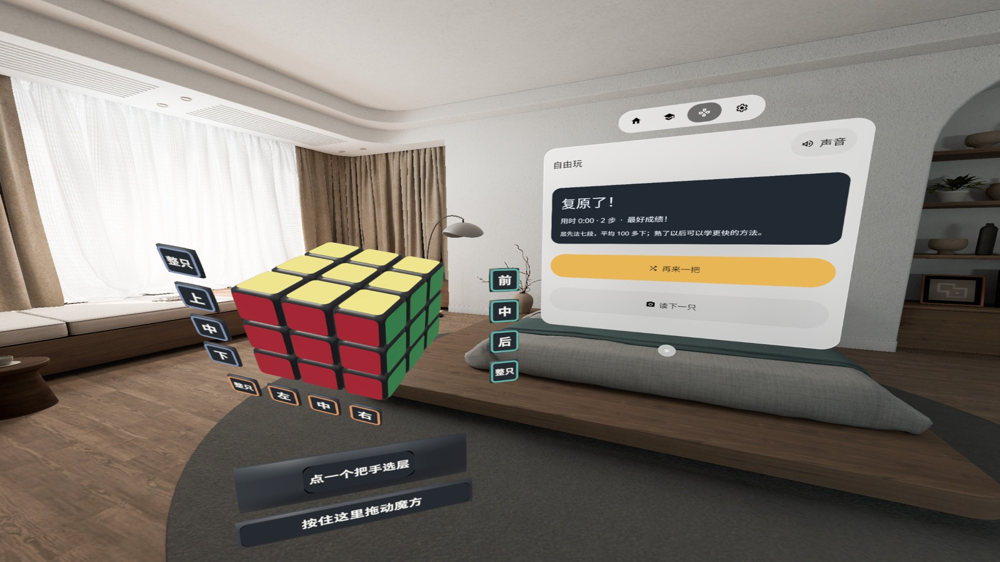

# Cube Tutor · 魔方复原课



**中文** · [English](#english)

PICO 空间应用（Full Space，透视）。头显相机一面一面读你手里的真魔方，每读完一面停下来给你确认；读不出来就点颜色。
身边浮起一只一模一样的虚拟魔方，七个阶段的层先法复原课一步一步带你转，每一步都告诉你「为什么这么转」。
没有魔方也可以：打乱一只虚拟魔方，跟着学或者自己玩。一个手柄就够：点魔方旁边的把手选层，推一下摇杆转 90°。

## 下载

[Release v0.1.3](https://github.com/kejing-dev/CubeTutor/releases/tag/v0.1.3) · `CubeTutor-v0.1.3.apk`（未签名 release 包）

```bash
adb install -r CubeTutor-v0.1.3.apk
pico-cli app launch com.kejing.cubetutor
```

PICO OS 6 · PICO Spatial SDK 6.1.9 · 包名 `com.kejing.cubetutor` · 权限只有相机（第一次点「读我的魔方」时才问） · 不联网

## v0.1.3 改了什么

- **逐面确认**：每读一面，相机停下，九格放大给你看，点格子改颜色，再按「对，下一面」或「重扫这一面」。拿稳、正对相机才算读到。
- **读的就是要的那一面**：中心色按标准配色认，拿错面、重复拿同一面都会提示。
- **无贴纸魔方也能找格**：靠缝和颜色边界分格，同色相邻合成一块也能对上 3×3。
- **白平衡学色**：灰世界白平衡 + 亮度归一，参考色在头显上实测，每确认一面就再学一次。
- **课程「为什么」卡**：每一步都显示所属公式（当前这一下高亮）、这一下干什么、整组做完达到什么；半圈按一次 180° 预演。

## 截图

截图在模拟器里拍（v0.1.3），不是真实房间；模拟器上的相机读入用的是注入的合成图片，真魔方只能在头显上读。

| | |
|---|---|
|  开始：读我的魔方 / 虚拟魔方 |  逐面确认：九格放大，点格子改颜色 |
|  读好了，和手里那只一模一样 |  复原课：右面往上，跟着亮的箭头 |
|  点把手选中一列，推摇杆转 |  为什么：这一下属于哪个公式 |
|  自由玩：复原了 | |

演示视频如有，均为模拟器录屏（非真实手势录像）。

---

## English

A PICO spatial app (Full Space, passthrough). The headset camera reads the real cube in your hand one side at a time
and stops after each side so you can confirm it; if a side won't read, tap its colours. A twin virtual cube floats
beside you and a seven-stage layer-by-layer lesson walks you through every move, each with the reason behind it.
No cube at hand? Scramble a virtual one and learn or play. One controller is enough: tap a handle beside a layer,
push the stick one notch for a quarter turn.

### Download

[Release v0.1.3](https://github.com/kejing-dev/CubeTutor/releases/tag/v0.1.3) · `CubeTutor-v0.1.3.apk` (unsigned release build)

```bash
adb install -r CubeTutor-v0.1.3.apk
pico-cli app launch com.kejing.cubetutor
```

PICO OS 6 · PICO Spatial SDK 6.1.9 · package `com.kejing.cubetutor` · camera permission only (asked the first time
you tap Read my cube) · no network

### What's new in v0.1.3

- **Per-side confirm**: after each side the camera pauses and shows the nine squares big; tap one to fix it, then
  "right, next side" or "rescan this side". A side is only taken when held still and square to the camera.
- **The side read is the side asked for**: centres follow the standard colour scheme; a wrong or repeated side is caught.
- **Stickerless cubes**: tiles are split by seams and colour edges, and the 3×3 lattice also fits merged same-colour areas.
- **White balance**: gray-world balance and brightness normalisation, reference colours measured on the headset,
  re-learned from every confirmed side.
- **"Why" card in the lesson**: the formula each move belongs to (this move lit), what this move does and what the
  whole group achieves; half turns preview as one 180° turn.

Screenshots above are from the emulator (v0.1.3), not a real room; reading a real cube needs the headset camera.
Any demo video is an emulator screen recording, not real hand gestures.

Developer notes: [AGENTS.md](AGENTS.md).
